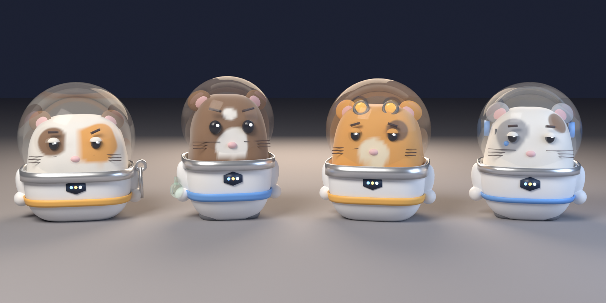
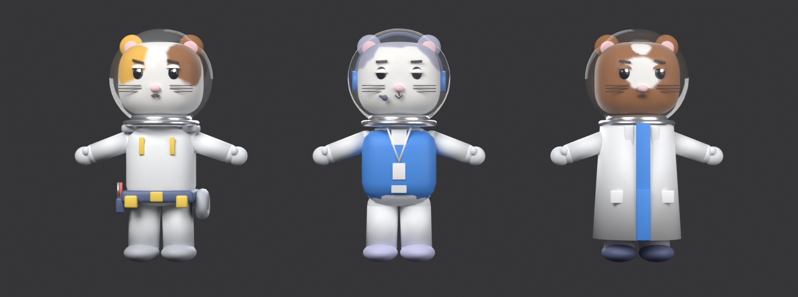
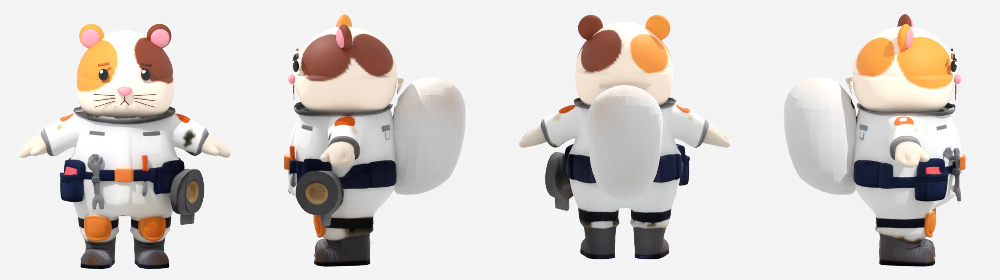
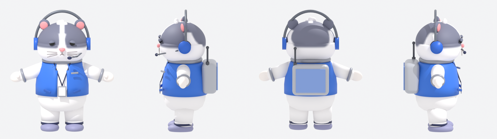
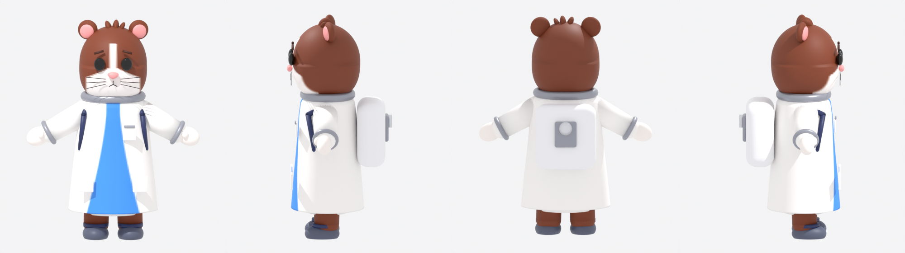
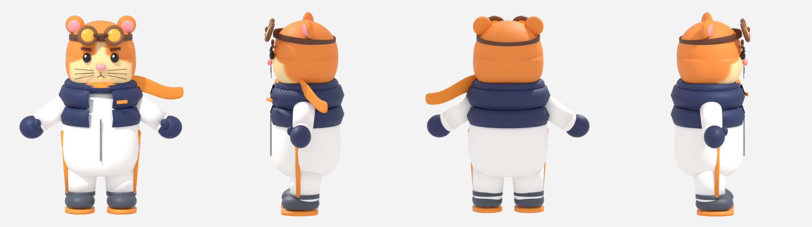

# The cuy crew (issue #44, for v0.3.0)

Four cuy astronauts (Andean guinea pigs), the protagonists of the v0.3.0 story (`docs/design/story-v0.3.0.md`).
Our own design, modelled by script in Blender (`assets/source/crew_cuy.py` and one script per cuy). Two AI tools helped,
and the README's "Use of AI" says so: **Meshy** made the 3D reference the team measured the cuyes on, and **TRELLIS**
made Rumi's body from a screenshot of it. The images in `ai-references/` hold those AI references.

| Name (proposed) | Station | Build and face | Coat | Stripe | Prop |
|---|---|---|---|---|---|
| Rumi (stone) | Engineer | short and stocky; unimpressed, one brow up, a flat mouth | white, ginger and chocolate | amber | a wrench |
| Killa (moon) | Scientist | tall and slim; wide open eyes, brows up, a small "o" | chocolate, white blaze | blue | a flask |
| Inti (sun) | Pilot | middle; eyes narrowed, brows slanted in, a half smile | ginger, cream muzzle | amber | goggles |
| Wayra (wind) | Ground control | middle, softest corners; nearly asleep, the cuy's "y" mouth | white, slate | blue | a headset |

The look: an upright, slightly boxy body with no neck (as the reference sticker's cuy), a deadpan face (small dark eyes half under a flat lid, a pink nose, a tiny
mouth, whiskers), fur in three colours as vertex colours, a short white suit in the game's palette, and a clear bubble
helmet so the face reads. Stylized next to documentary-real craft, as `docs/design/criteria.md` allows for characters.

Names and look to be confirmed by both team members before they go into the game.

## Second look: full figures in T-pose (the team's reference)

Rumi with a work suit, tool belt, pouches, knee pads and a roll of tape; Wayra with a blue vest, a badge on a lanyard,
a headset and an antenna; Killa with a long lab coat and a blue stripe. Built by `assets/source/crew_cuy_tpose.py`
(Blender, from primitives) to match a reference sheet the team made with **Meshy (an AI 3D tool)**: if these are used,
the README's "Use of AI" says so. The pilot (Inti) waits for its reference. Models:
`assets/models/crew/crew_{rumi,wayra,killa}_tpose.glb`.

## Rumi matched to the Meshy reference

`assets/models/crew/crew_rumi_meshy.glb`, built by `assets/source/crew_rumi_meshy.py`. The body (suit, tool belt,
tools, knee pads, boots, tape, backpack) is `assets/source/rumi_trellis_body.glb`, made with **TRELLIS** (an AI
image-to-3D model, Hugging Face Space trellis-community/TRELLIS) from a screenshot of the team's **Meshy** (AI) model;
the head, the face and the patches are built in Blender by the script (no helmet: the face is in the open, a team decision for expression and animation), measured on the reference (side by side: `ai-references/rumi-head-compare.png`, the reference on the left). Both tools are AI: if this model
is used, the README's "Use of AI" and `docs/sources.md` say so. About 40,000 faces.

## Wayra matched to the Meshy reference

`assets/models/crew/crew_wayra_meshy.glb`, built entirely in Blender by `assets/source/crew_wayra.py` (no generated
mesh), measured on screenshots of the team's **Meshy** (AI) model from the front, the sides and the back (side by
side with the reference: `ai-references/wayra-compare.png`). No helmet. If used, the README's "Use of AI" names Meshy as the
reference.

## Killa matched to the Meshy reference

`assets/models/crew/crew_killa_meshy.glb`, built entirely in Blender by `assets/source/crew_killa.py`, measured on
screenshots of the team's **Meshy** (AI) model from the front, the sides and the back (side by side with the reference:
`ai-references/killa-compare.png`). No helmet.

## Inti matched to the Meshy reference

`assets/models/crew/crew_inti_meshy.glb`, built entirely in Blender by `assets/source/crew_inti.py`, measured on
screenshots of the team's **Meshy** (AI) model from the front, the sides and the back (side by side with the reference:
`ai-references/inti-compare.png`). No helmet.
